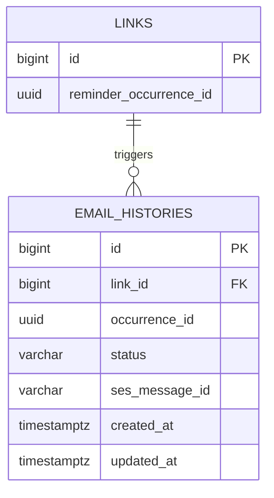

# email_histories

링크 리마인드 이메일의 회차별 발송 상태를 저장하는 테이블이다.

## ERD



## 필드

| 필드 | 타입 | 필수 | 설명 |
| --- | --- | --- | --- |
| id | bigint | Y | 이메일 발송 이력 식별자. identity PK |
| link_id | bigint | Y | 대상 링크 ID |
| occurrence_id | uuid | Y | 이메일·푸시가 공유하는 리마인드 회차 UUID |
| status | varchar(20) | Y | `PENDING`, `ACCEPTED`, `FAILED`, `UNKNOWN`. 기본값 `PENDING` |
| ses_message_id | varchar(255) | N | SES 접수 ID |
| created_at | timestamptz | Y | 이력 생성 일시. 기본값 `now()` |
| updated_at | timestamptz | Y | 상태 수정 일시. 기본값 `now()`, 갱신 시 직접 설정 |

## 제약

- `link_id`는 `links.id`를 참조하며, 링크 영구 삭제 시 함께 삭제된다. (`ON DELETE CASCADE`)
- `(link_id, occurrence_id)`는 유니크하다.
- `occurrence_id`는 UUID 자동 생성 기본값을 두지 않는다. `links.reminder_occurrence_id`에 대한 물리 FK는 없다.
- `status`는 CHECK로 필드 표에 명시된 값만 허용한다.
- `ACCEPTED` 상태는 `ses_message_id`가 NULL일 수 없다.

## 인덱스 설계

```sql
-- UNIQUE 제약으로 생성되는 인덱스
CREATE UNIQUE INDEX email_histories_link_occurrence_unique
  ON email_histories (link_id, occurrence_id);

CREATE INDEX email_histories_status_updated_at_idx
  ON email_histories (status, updated_at);
```

- `(link_id, occurrence_id)` (유니크): 회차 중복 방지와 링크별 이력 조회.
- `(status, updated_at)`: 상태별 처리 대기·오래된 이력 조회.
