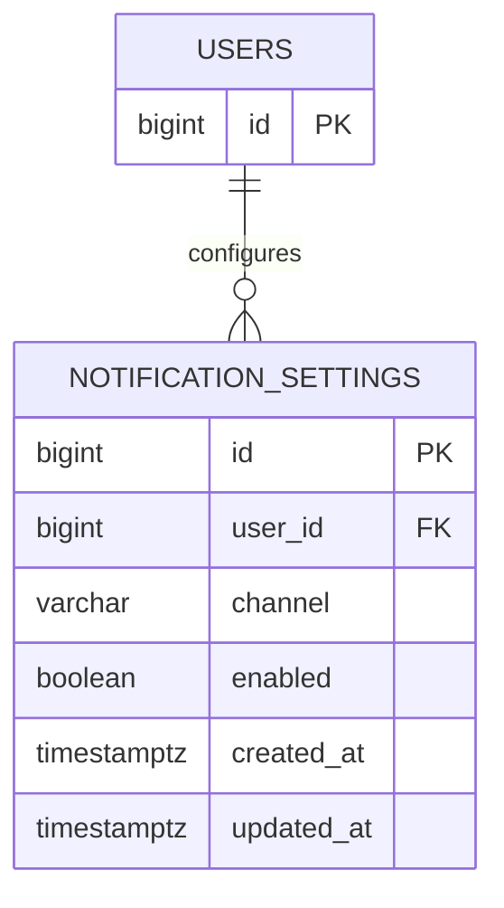

# notification_settings

회원의 채널별 알림 수신 여부를 저장하는 테이블이다. 회원마다 이메일·푸시 설정을 각각 하나씩 저장할 수 있다.

## ERD



## 필드

| 필드 | 타입 | 필수 | 설명 |
| --- | --- | --- | --- |
| id | bigint | Y | 수신 설정 식별자. identity PK |
| user_id | bigint | Y | 설정 소유 회원 ID |
| channel | varchar(10) | Y | 알림 채널. `email`, `push` |
| enabled | boolean | Y | 수신 허용 여부. 기본값 없이 명시적으로 지정 |
| created_at | timestamptz | Y | 생성 일시. 기본값 `now()` |
| updated_at | timestamptz | Y | 수정 일시. 기본값 `now()`, 갱신 시 직접 설정 |

## 제약

- `user_id`는 `users.id`를 참조하며, 회원 영구 삭제 시 함께 삭제된다. (`ON DELETE CASCADE`)
- `(user_id, channel)`은 유니크하다.
- `channel`은 CHECK로 `email`, `push`만 허용한다.

## 인덱스 설계

```sql
-- UNIQUE 제약으로 생성되는 인덱스
CREATE UNIQUE INDEX notification_settings_user_channel_unique
  ON notification_settings (user_id, channel);
```

- `(user_id, channel)` (유니크): 설정 중복 방지와 회원별 채널 설정 조회. 선두 컬럼이 `user_id`이므로 별도 회원 인덱스는 두지 않는다.
