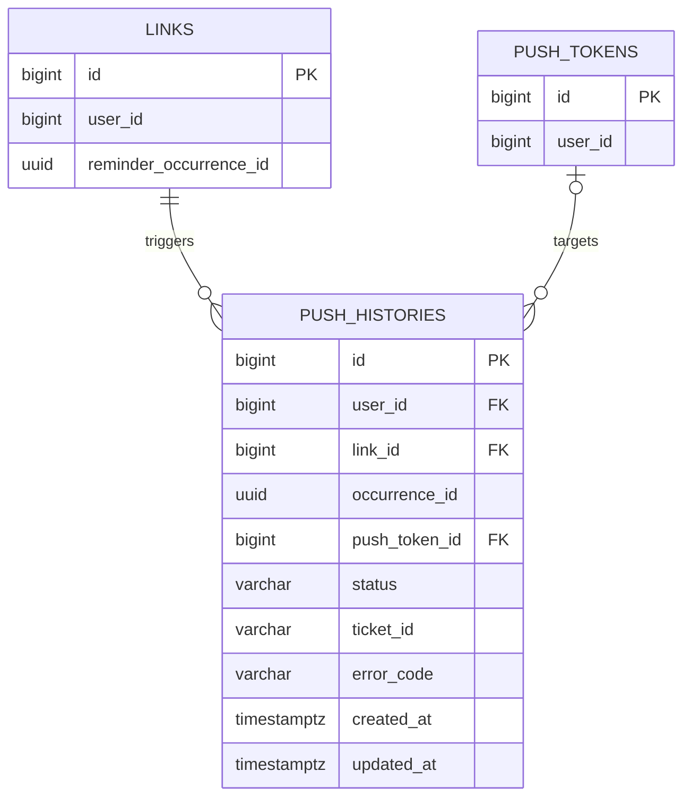

# push_histories

링크 리마인드 푸시의 회차·기기별 발송 상태를 저장하는 테이블이다.

## ERD



## 필드

| 필드 | 타입 | 필수 | 설명 |
| --- | --- | --- | --- |
| id | bigint | Y | 푸시 발송 이력 식별자. identity PK |
| user_id | bigint | Y | 링크와 푸시 토큰의 공통 소유 회원 ID |
| link_id | bigint | Y | 대상 링크 ID |
| occurrence_id | uuid | Y | 이메일·푸시가 공유하는 리마인드 회차 UUID |
| push_token_id | bigint | N | 대상 기기의 토큰 ID. 토큰 삭제 시 NULL |
| status | varchar(20) | Y | `PENDING`, `ACCEPTED`, `RECEIPT_OK`, `FAILED`, `UNKNOWN`. 기본값 `PENDING` |
| ticket_id | varchar(255) | N | 푸시 제공자의 접수 ID |
| error_code | varchar(100) | N | 푸시 제공자 오류 코드 |
| created_at | timestamptz | Y | 이력 생성 일시. 기본값 `now()` |
| updated_at | timestamptz | Y | 상태 수정 일시. 기본값 `now()`, 갱신 시 직접 설정 |

## 제약

- `(link_id, user_id)`는 `links(id, user_id)`를 참조하며, 링크 영구 삭제 시 함께 삭제된다. (`ON DELETE CASCADE`)
- `(push_token_id, user_id)`는 `push_tokens(id, user_id)`를 참조해 링크와 토큰의 소유자 일치를 강제한다. 토큰 삭제 시 이력과 `user_id`는 유지하고 `push_token_id`만 NULL로 바뀐다. (`ON DELETE SET NULL (push_token_id)`)
- 컬럼 지정 `SET NULL`은 현재 Drizzle 선언으로 표현하지 못하므로 `0017_push_history_owner.sql`에서 지정한다. FK 재생성 시에도 동일하게 유지해야 한다.
- `(link_id, occurrence_id, push_token_id)`는 유니크하다. NULL은 서로 다른 값으로 취급하므로 토큰 삭제 후 NULL이 된 여러 기기의 이력도 유지할 수 있다.
- `occurrence_id`에는 UUID 자동 생성 기본값과 `links.reminder_occurrence_id`에 대한 물리 FK를 두지 않는다.
- `status`는 CHECK로 필드 표에 명시된 값만 허용한다. `ACCEPTED`, `RECEIPT_OK` 상태는 `ticket_id`가 NULL일 수 없다.

## 인덱스 설계

```sql
-- UNIQUE 제약으로 생성되는 인덱스
CREATE UNIQUE INDEX push_histories_link_occurrence_token_unique
  ON push_histories (link_id, occurrence_id, push_token_id);

CREATE INDEX push_histories_push_token_id_idx
  ON push_histories (push_token_id);

CREATE INDEX push_histories_status_updated_at_idx
  ON push_histories (status, updated_at);
```

- `(link_id, occurrence_id, push_token_id)` (유니크): 회차·기기별 중복 방지와 링크별 이력 조회.
- `push_token_id`: 기기별 이력 조회와 토큰 삭제 시 참조 행 탐색.
- `(status, updated_at)`: 발송 처리·receipt 조회 대상 탐색.
