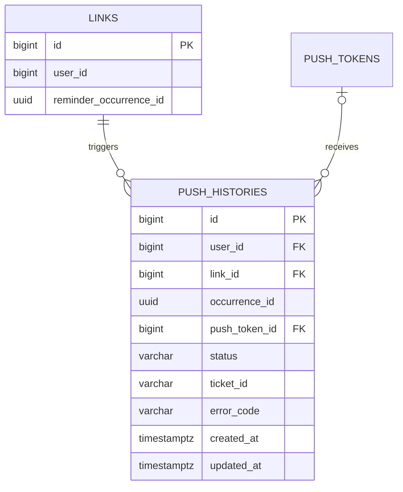

# push_histories

링크 리마인드 푸시의 발송 결과와 ticket을 저장하는 테이블이다.

## ERD



## 필드

| 필드 | 타입 | 필수 | 설명 |
| --- | --- | --- | --- |
| id | bigint | Y | 푸시 발송 이력 식별자. identity PK |
| user_id | bigint | Y | 링크 소유 회원 ID |
| link_id | bigint | Y | 대상 링크 ID |
| occurrence_id | uuid | Y | 이메일·푸시가 공유하는 리마인드 회차 UUID |
| push_token_id | bigint | N | 받은 기기의 푸시 토큰 ID. 토큰이 삭제되면 `NULL` |
| status | varchar(20) | Y | `PENDING`, `ACCEPTED`, `RECEIPT_OK`, `FAILED`, `UNKNOWN`. 기본값 `PENDING` |
| ticket_id | varchar(255) | N | 푸시 제공자의 접수 ID |
| error_code | varchar(100) | N | 실패 사유. Expo 오류 코드(`DeviceNotRegistered`, `MessageRateExceeded` 등) 또는 서버 내부 코드(`REQUEST_FAILED`: 요청 실패로 접수 여부 모름, `TOKEN_NOT_OWNED`: 보내기 직전 토큰이 지워졌거나 다른 계정 소유, `NOT_SENT`: Expo 요청 전 단계에서 실패해 보내지 않음) |
| created_at | timestamptz | Y | 이력 생성 일시. 기본값 `now()` |
| updated_at | timestamptz | Y | 상태 수정 일시. 기본값 `now()`, 갱신 시 직접 설정 |

## 제약

- `(link_id, user_id)`는 `links(id, user_id)`를 참조해 링크 소유자와 이력 소유자의 일치를 강제하며, 링크 영구 삭제 시 함께 삭제된다. (`ON DELETE CASCADE`)
- `occurrence_id`에는 UUID 자동 생성 기본값과 `links.reminder_occurrence_id`에 대한 물리 FK를 두지 않는다.
- `status`는 CHECK로 필드 표에 명시된 값만 허용한다. `ACCEPTED`, `RECEIPT_OK` 상태는 `ticket_id`가 NULL일 수 없다.
- `push_token_id`는 `push_tokens.id`를 참조하며, 토큰 삭제 시 `NULL`로 바꾸고 이력은 유지한다. (`ON DELETE SET NULL`)
- `(link_id, occurrence_id, push_token_id)`는 유니크하다. 한 회차는 기기마다 한 번만 발송하며, 리마인드 배치는 이 제약으로 기기별 첫 발송을 선점한다. `push_token_id`가 `NULL`인 이력끼리는 겹칠 수 있다.
- 계정 전환으로 토큰 소유자가 바뀔 수 있어 `(push_token_id, user_id)` 소유자 복합 FK는 두지 않는다. `DeviceNotRegistered`로 토큰을 정리할 때는 이력의 `user_id`와 토큰 소유자를 함께 조건으로 쓴다.

## 인덱스 설계

```sql
CREATE INDEX push_histories_link_id_idx
  ON push_histories (link_id);

CREATE INDEX push_histories_status_updated_at_idx
  ON push_histories (status, updated_at);

CREATE INDEX push_histories_push_token_id_idx
  ON push_histories (push_token_id);

-- UNIQUE 제약으로 생성되는 인덱스
CREATE UNIQUE INDEX push_histories_link_occurrence_token_unique
  ON push_histories (link_id, occurrence_id, push_token_id);
```

- `link_id`: 링크별 이력 조회와 링크 영구 삭제 시 참조 행 탐색.
- `(status, updated_at)`: 발송 처리·receipt 조회 대상 탐색.
- `push_token_id`: 토큰 삭제 시 참조 행 탐색.
- `(link_id, occurrence_id, push_token_id)` (유니크): 기기별 중복 발송 방지.
