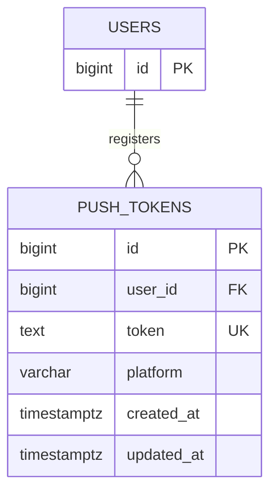

# push_tokens

회원의 기기별 푸시 토큰을 저장하는 테이블이다. 한 회원이 여러 기기를 등록할 수 있으며, 같은 토큰은 하나의 회원에게만 연결한다.

## ERD



## 필드

| 필드 | 타입 | 필수 | 설명 |
| --- | --- | --- | --- |
| id | bigint | Y | 푸시 토큰 식별자. identity PK |
| user_id | bigint | Y | 토큰 소유 회원 ID |
| token | text | Y | 발송에 사용하는 토큰 원문 |
| platform | varchar(10) | Y | 기기 플랫폼. `ios`, `android` |
| created_at | timestamptz | Y | 등록 일시. 기본값 `now()` |
| updated_at | timestamptz | Y | 수정 일시. 기본값 `now()`, 갱신 시 직접 설정 |

## 제약

- `user_id`는 `users.id`를 참조하며, 회원 영구 삭제 시 함께 삭제된다. (`ON DELETE CASCADE`)
- `token`은 전역 유니크이며 공백만으로 구성된 값은 CHECK로 거부한다.
- `platform`은 CHECK로 `ios`, `android`만 허용한다.

## 인덱스 설계

```sql
-- UNIQUE 제약으로 생성되는 인덱스
CREATE UNIQUE INDEX push_tokens_token_unique ON push_tokens (token);

CREATE INDEX push_tokens_user_id_idx ON push_tokens (user_id);
```

- `token` (유니크): 중복 등록 방지와 토큰 단건 조회.
- `user_id`: 회원별 발송 대상 조회와 토큰 정리.
