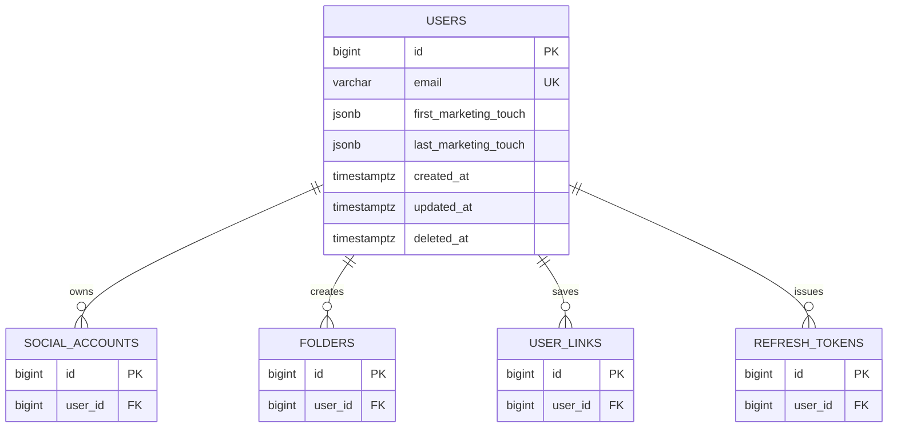

# users

회원 계정의 기준 테이블이다. 설정 화면의 이메일 표시, 회원 탈퇴 처리 시점, 사용자별 링크/폴더 소유권의 기준이 된다.

## ERD

## 필드

| 필드 | 타입 | 필수 | 설명 |
| --- | --- | --- | --- |
| id | bigint | Y | 회원 식별자 |
| email | varchar | Y | 설정 화면에 표시할 대표 이메일 |
| first_marketing_touch | jsonb | N | 계정에 처음 저장된 유효 마케팅 접점. 이후 보존 |
| last_marketing_touch | jsonb | N | 수집 시각이 가장 최근인 마케팅 접점 |
| created_at | timestamptz | Y | 회원 생성 일시 |
| updated_at | timestamptz | Y | 회원 정보 수정 일시 |
| deleted_at | timestamptz | N | 회원 탈퇴 또는 소프트 삭제 일시 |

## 제약

- `email`은 대표 이메일 기준으로 유니크하게 관리한다.
- 이메일 미제공 소셜 계정 또는 동일 이메일 계정 병합은 인증 정책에서 결정한다.

## 마케팅 접점

두 컬럼은 `touch_id`, `captured_at`, UTM 다섯 필드를 담은 객체 또는 SQL `NULL`이다. `model`·`scope`는 이벤트의 해석 정보이므로 DB 객체에는 넣지 않는다. 이벤트의 발생 시점에는 `last_marketing_touch`를 복사해 사용한다.

`PATCH /users/me/attribution`이 인증된 사용자의 행을 트랜잭션에서 잠그고 갱신한다. 최초 접점은 한 번만 저장하고, 최근 접점은 더 최근 `captured_at`이 들어왔을 때 전체를 교체한다. 직접 방문·과거 접점·동일 시각의 재시도는 기존 값을 유지한다. 최초 접점은 전 기기의 과거 이력을 재구성한 최솟값이 아니라 계정에 처음 저장된 접점이다.

필드 검증과 API 응답은 [사용자 API 명세](../../api/user.md)에 정리했다. `0014_user_marketing_attribution.sql`은 nullable 컬럼 두 개만 추가하며 기존 사용자·접점을 삭제하거나 백필하지 않는다.
